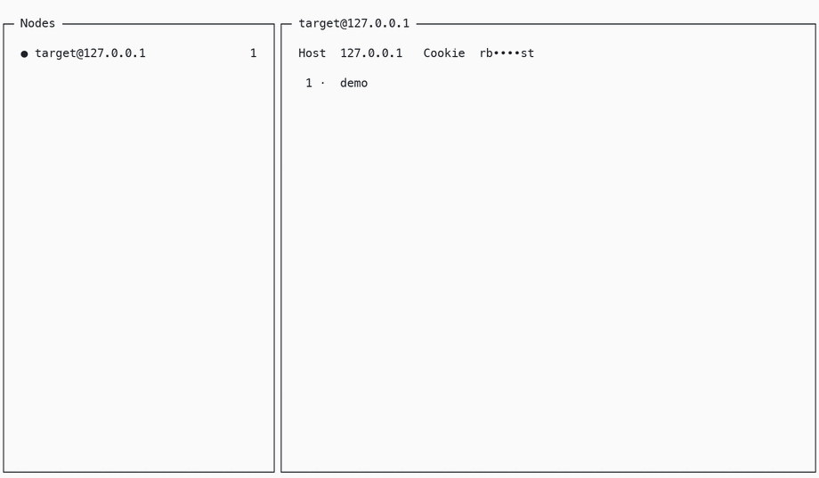

# redbug-cli

A terminal UI for tracing remote Erlang and Elixir nodes with
[redbug](https://hex.pm/packages/redbug), without adding code, installing an agent, or deploying
anything to the target node.

[](LICENSE)



> Connect to a live node, stream call/return events, fold each pair into one row, and open any
> event in a detail pane — all from the terminal.

## Why redbug-cli?

- **Nothing to install on the target.** No code change, no restart, no agent — attach to a running
  node and start watching.
- **Watch live activity.** See function calls, their return values, and messages between processes
  as they happen.
- **See what belongs together.** Each call and its return share a number and indent by depth, and
  fold into a single row on demand.
- **Follow messages.** Track messages sent and received to understand how processes talk to each
  other.
- **Run and reuse snippets.** Execute commands against the node from a built-in console and save the
  ones you come back to.
- **Reach nodes anywhere.** On your machine, across a private network, or behind SSH — including
  containerized deployments.
- **Pick up where you left off.** Sessions, trace patterns, snippets, and node config are saved.
- **Dig into any event.** Read payloads and stack traces in the TUI.

## Quick Start

Tool versions are pinned in [mise.toml](mise.toml). Install the toolchain, then run the dev task:

```sh
mise install   # Erlang and Elixir (from [tools])
mise run dev    # fetches deps if needed, then starts the controller with the TUI
```

This starts one BEAM in the terminal: the controller and the [Terra](https://github.com/uminocelo/terra) TUI. The log goes to `/tmp/redbug-server.log` (`REDBUG_SERVER_LOG`), not to the screen.

The workflow is driven by three [mise tasks](mise.toml) (`mise tasks` to list, `mise run <task>`):

| Task | Does |
|---|---|
| `setup` | Fetch the Elixir deps |
| `dev` | Start the controller with the TUI in this terminal (`RB_COOKIE`, default `rbtest`) |
| `package` | Build the release `server/_build/prod/rel/server` (ERTS included) |

`dev` and `package` depend on `setup`, so a fresh checkout only needs `mise install` first.

In another terminal, start a throwaway target node with the same cookie:

```sh
iex --name target@127.0.0.1 --cookie rbtest
```

Define and call something in that `iex` session:

```elixir
defmodule Demo do
  def add(a, b), do: a + b
end

Demo.add(1, 2)
```

In redbug-cli (press `?` at any time for the active screen's keys):

1. Add node `target@127.0.0.1` with cookie `rbtest`.
2. Connect to it.
3. Create a session under the node (name it, pick a preset).
4. Open the session, add the trace `Demo.add/2 -> return`, and enable it.
5. Start tracing.
6. Call `Demo.add(1, 2)` again in `iex`.

The call and return events stream into the session.

## Install / Package

Build the release and start it:

```sh
mise run package
server/_build/prod/rel/server/bin/server start
```

The release includes the ERTS that builds it, and runs the controller and the TUI in one BEAM. When the TUI quits, the BEAM stops. Use `bin/server start` in a terminal: the TUI needs the terminal, and the controller does not register in epmd, so `bin/server stop`, `rpc`, and `remote` cannot reach it. Quit with `q`. A single-file executable is not available now: the Bun build that made `dist/redbug` is removed, and `mix pbeam.build` is the next step (see `docs/terra-gaps.md`).

Current packaging target: macOS arm64.

## Keybindings

Press `?` in the TUI for the active screen's keymap.

## Tracing Remote Nodes

### Supported target versions

The controller runs Erlang/OTP 29.1.1. A target node can run OTP 27, 28, or 29. The tests check
OTP 27.2.4, 28.5.0.2, and 29.1.1 (`test/remote/inject_test.exs`).

A beam that OTP 29 compiles does not load on OTP 27, so the controller does not send its beams. It
sends the abstract code of the console worker and of the redbug target modules, and the target
compiles them with its own `compiler` application. A target without `compiler` gets the
controller's beams, and an older OTP can refuse them.

The console runs Elixir code on a target with Elixir, and Erlang code on each target. A final dot
marks Erlang code: the console then formats and runs the code as Erlang on each target, so Erlang
code gives the same result and the same error text on both kinds of target. A target without Elixir
(a plain `erl` node) runs only Erlang code.

redbug-cli supports three remote-node paths:

| Target shape | Use |
|---|---|
| SSH-only host with a Docker/Kamal container | Built-in SSH tunnel |
| Routable host over VPN/LAN/WireGuard | Direct Erlang distribution |
| CI or custom tunnel setup | `REDBUG_NODES` |

For details, see [Remote nodes](docs/remote-nodes.md).

## Configuration

Config is persisted to `~/.config/redbug/config.json` and honors `$XDG_CONFIG_HOME`. The file
stores nodes, sessions, presets, snippets, and settings. Cookies are stored in plaintext, so keep
the config local and private.

| Variable | Component | Default | Purpose |
|---|---|---|---|
| `REDBUG_NODES` | server | - | Env-injected nodes: `name@host\|dial_ip:port\|cookie` |
| `RB_COOKIE` | dev | `rbtest` | Cookie used by `mise run dev` |
| `CONTROLLER_NODE` | server | `redbug_controller@127.0.0.1` | Controller node name |
| `CONTROLLER_DISTRIBUTION` | server | `name` | Use `sname` for shortname targets |
| `REDBUG_DIST` | server | on | `off` starts the controller without distribution (for a VM without distribution, such as PBeam): local nodes, sessions, presets, and snippets work, and a connect fails |
| `REDBUG_SERVER_LOG` | server | `/tmp/redbug-server.log` | Log file while the TUI holds the terminal |
| `XDG_CONFIG_HOME` | server | `~/.config` | Config base directory |

## Security

- The Erlang distribution cookie is remote-code-execution capability on the target.
- Erlang distribution is unencrypted unless tunnelled; use SSH or a trusted private network.
- Do not expose epmd or distribution ports to untrusted networks.

## Development

```sh
cd server && mix test
```

The trace and console tests (`test/trace/lifecycle_test.exs`, `test/remote/console_test.exs`, and the live tests of `test/tui/`) run against a real target node, so start a target like the quick-start `iex` node first when running the whole server test suite. The server tests need a distributed VM: `elixir --name rbe2e@127.0.0.1 --cookie rbtest -S mix test`. The tests drive the TUI headless with `Terra.Test`; `config/test.exs` turns off the start of the TUI.

`test/remote/inject_test.exs` starts its own target nodes of OTP 27, 28, and 29. It uses the extra
Erlang and Elixir versions in [mise.toml](mise.toml), which `mise install` installs.

### Architecture

redbug-cli is one Elixir application in one BEAM:

- **Controller**: it owns the config, connects to target nodes, and runs redbug.
- **TUI**: a [Terra](https://github.com/uminocelo/terra) app in the same BEAM. It calls the controller directly and gets its updates as local messages. [docs/terra-gaps.md](docs/terra-gaps.md) records the features of the old Bun TUI that Terra cannot show.

The domain model is:

```text
Node -> Session -> Trace patterns -> Events
```

## Documentation

- [Architecture](docs/ARCHITECTURE.md)
- [Remote nodes](docs/remote-nodes.md)
- [Testing & screenshots](docs/testing.md)

## License

[MIT](LICENSE) © Phil Chen
